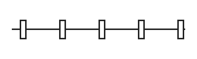

# 离线笔记的写作与整理流程

这份指南写给刚开始用 Green 的人。它不解释按钮在哪，只讲怎么把一堆 Markdown 文件
变成一个能长期用的资料库——目录怎么分、命名怎么定、什么该写在文件里、什么该留在
视图里。全文两千六百余字，读完大概十分钟。

## 一、先决定一件事：文件放在哪

笔记应用最容易失败的地方，不是功能少，而是位置没定下来。定下来的意思是：今天写的
文件，三年后还能找到，而且不需要任何软件才能打开。所以第一件事是把根目录选好。

建议的结构：

```
笔记/
  2026/
    11/
      2026-11-20-项目周会.md
      2026-11-22-读书笔记.md
  主题/
    排版/
    性能/
  归档/
    2025/
```

三种分法各有代价：

| 分法 | 好处 | 代价 |
| --- | --- | --- |
| 按时间 | 好找、好归档、不会重复 | 主题跨越多个目录，靠搜索 |
| 按主题 | 一个主题一个家 | 主题会分裂，命名会打架 |
| 混合 | 日常按时间，长期按主题 | 要定期搬，搬家要规矩 |

我的做法是混合：日常记在 `2026/11/` 下，每周末把值得留的几篇搬到 `主题/` 里，
搬的时候顺手改名字。搬完不删原文，留着当时间线。

## 二、命名：日期在前，主题在后

`2026-11-20-项目周会.md` 这个格式的好处是排序稳定：按文件名排就是按时间排，
不用读文件内容。坏处是标题里不能有 `/` 和 `:`——Windows 上这两个字符会出事，
所以标题里用 `-` 和空格。

规则就那么几条：

1. 日期用 `YYYY-MM-DD`，不要用 `11月20日`，也不要省年份。
2. 日期与主题之间用 `-`，主题内部的词用空格或下划线。
3. 主题不超过八个字，超过就说明这一篇该拆。
4. 不写版本号（`v2`、`最终版`），版本交给文件系统与 Git。

> 一条经验：如果一篇笔记的名字里出现「临时」「待整理」「新」，它大概率永远不会被整理。

## 三、一篇笔记该有什么

一篇能长期用的笔记，通常有四块：结论、依据、过程、待办。顺序不重要，但四块都得有，
缺哪一块，三个月后自己就看不懂了。

### 3.1 结论写在最前面

不要写成小说的结构——铺垫三千字，最后一句才是答案。把答案放第一段，后面都是支撑材料。
读者（包括三个月后的自己）读完第一段就能决定要不要往下看。

### 3.2 依据要能复现

凡是引用了数字，就写清楚它怎么来的：哪台机器、哪个版本、跑了多少次。比如
「打开五万字文档耗时 380 ms」，如果没写机型与样本数，这个数字三个月后就没用了。

复现步骤写成编号列表，命令用代码块：

```sh
cargo build -p green --release
ELY_LOG=info target/release/green.exe fixtures/perf/50k-paragraphs.md
```

### 3.3 过程留在折叠里

Green 按标题折叠正文，所以把过程放在子标题下面，需要的时候展开，不需要的时候收起来。
折叠只改视图，不改文件——这一点很重要，意味着你随时可以放心地折叠，不会丢内容。

### 3.4 待办单独一节

待办不写在正文中间，集中放在最后一节，每条一个复选框：

- [x] 把根目录定在 `D:\笔记`
- [x] 定下命名规则
- [ ] 把这周的七篇搬到 `主题/排版/`
- [ ] 删掉 `归档/2025/` 里重复的三篇

## 四、表格与列表的取舍

表格适合「多个对象、同样的几个属性」；列表适合「一个对象的多个步骤」。判断方法很简单：
如果每一行的第一列是同一类东西的名字，用表格；如果每一行都是「然后、接着、最后」，用列表。

宽表要小心。超过六列的表格在窄窗口里会挤成一团，解决办法是拆成两张表，或者把不重要的列
挪到正文里说。下面这张就是拆过的例子：

| 指标 | 目标 | 实测 |
| --- | --- | --- |
| 打开五万字到可输入 | ≤ 400 ms（p95） | 380 ms |
| 折叠一次 | ≤ 16 ms | 9 ms |
| 滚动掉帧 | < 1% | 0.3% |

## 五、公式怎么写

行内公式用单个美元符号包起来，比如质能关系 \(E = mc^2\)，它随文排版，不换行。
需要独立成行的就用双美元符号：

\[
\int_0^T \left| v(t) \right| \mathrm{d}t = s
\]

写作业、写推导的时候，公式前后都要有文字说明「这个式子在算什么」，否则半年后只剩符号。
公式里不要塞中文，需要中文就挪到公式外面。



## 六、图片与附件

图片放在文档旁边的 `images/` 目录里，用相对路径引用。绝对路径在自己机器上没问题，
换一台机器就全断了。附件（PDF、表格）同理，放在 `files/` 里，正文用链接指过去。

一条底线：图片与附件都是文件，删文档之前先看一眼它引用了什么。Green 不会替你删附件，
也不会替你恢复。

## 七、什么时候该拆

出现下面任意一条，就该把一篇拆成两篇：

1. 标题超过八个字，而且前半段与后半段讲的不是一件事。
2. 一篇文章里出现了两个以上的「结论」。
3. 折叠起来以后，目录里超过十个二级标题。

拆的时候保留原文，新建两篇，各自链回原文。这样时间线不丢，结构也变清楚了。

## 八、备份

笔记是文件，备份就是复制文件。三条规则：

1. 每天一次整目录复制到另一块盘。
2. 每周一次离线（移动硬盘或另一台机器）。
3. 每季度试着从备份恢复一次——没恢复过的备份不算备份。

不要用「同步盘」当备份：同步会把误删同步过去，而备份不会。

## 九、搜索与标签

目录决定「东西放在哪」，搜索决定「东西怎么找回来」，两者不能互相替代。搜索的门槛低，
但结果没有结构；目录有结构，但要求你提前知道该放哪。所以两者都要：目录做粗分类，
搜索做细定位。

搜索的用法有讲究：

1. 先用短词，再用长词。中文的搜索是按子串匹配的，搜「折叠」比搜「折叠的视图状态」命中多。
2. 记得搜标题。找不到内容的时候，标题里往往有更准的词。
3. 搜不到就先怀疑自己记错了，而不是怀疑搜索坏了——这句话适用于九成的情况。

标签（`#排版` 这种）是目录与搜索之间的东西。它的好处是跨目录，坏处是容易泛滥：一旦允许
随手打标签，两个月后就会有四十个只用过一次的标签。我的做法是给标签定一个上限——十个，
加一个新的就得删一个旧的。这条规矩听起来武断，但它逼着人想清楚「这个标签以后还会用吗」。

还有一条经验：标签写在文件正文里，不要写进文件名。文件名要稳定，标签会变。

## 十、收尾

这套流程里没有一条是关于软件的。文件放哪、怎么命名、写完留什么——这些决定了三年后
这套笔记还能不能用；软件只决定今天写得顺不顺手。所以先把流程跑通，再挑工具。
