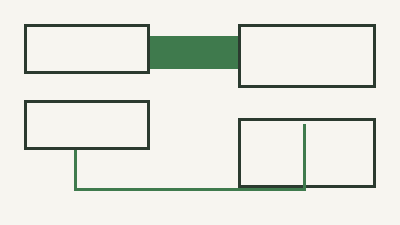

# 读书笔记：《排版的艺术》第三、四章

- 作者：Jan Tschichold（中译本）
- 读完：2026-11-12
- 标签：排版、字体、度量

## 三、版心与留白

留白不是「剩下的地方」，它是主动画出来的。作者把版心比作一张纸上的黑块，
四周的空白按 2:3:4:6 的比例分配——上、外、下、内，读起来最舒服。
中文竖排是另一套规矩，这里不展开。

> 「一行字的长度，决定了读者换气的节奏。」
>
> —— 第四章开头

这一点在屏幕上更难：窗口宽度可变，`48rem` 只是折中。行长（measure）与字号的关系，
经验上满足 \(m \approx 66\) 个字符时最好读；中文按全角算，一行的字数应更少。

## 四、行距与灰度

行距（leading）与字号（size）之比通常取 1.4–1.6。作者给的经验式：

\[ L = 1.2 + \frac{0.6}{m / 66} \]

排版灰度（type colour）是页面上黑白的整体浓淡。同一段文字，行距紧一点就发黑，
松一点就发灰；标题与正文的对比也是灰度问题。

| 元素 | 字号 | 行距 | 用途 |
| --- | --- | --- | --- |
| 正文 | 1.0× | 1.55× | 连续阅读 |
| 标题一 | 1.6× | 1.2× | 章 |
| 标题二 | 1.35× | 1.25× | 节 |
| 注 | 0.85× | 1.4× | 脚注、图注 |

## 五、我的结论

1. 先把度量定下来，再谈颜色；灰度是结果，不是目标。
2. 中文断行要避免「孤字」与「孤行」，这一条比西文更严格。
3. 行内公式的字号应与正文一致，不能因为公式是图片就缩半号——这是 ==这一章里最有用的一句==。

待办：把行距与字号的对应关系抄进设计文档的正文规范一节（、这本书的第 4 章第 2 节）。
